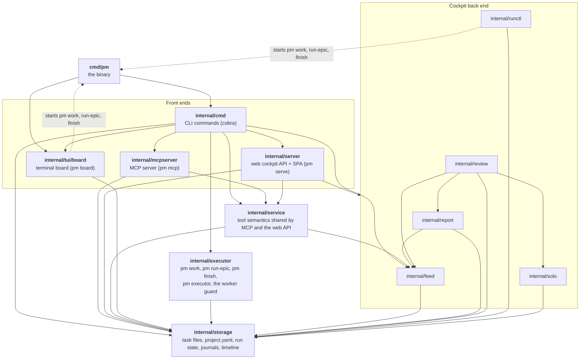

# Architecture

pm is one data layer with several front ends on top of it, plus the executor as a module beside them. Everything lives in one binary, `cmd/pm`. The diagram is drawn from the real import graph (`go list -f '{{.ImportPath}}: {{join .Imports " "}}' ./...`): a solid arrow means "imports", and every one of them is an import in the code. A dashed arrow is not an import. It marks a process boundary: the package starts `pm` as a child process to run the executor. These are not the only `pm` child processes. The board also runs `pm runs --json`, and the executor runs `pm finish` after `run-epic --then-finish` and registers `pm worker-guard` as a hook.

## The boxes

- **`internal/storage`** - the data layer. Tasks are markdown files with YAML frontmatter under `~/.claude/pm/<project>/`, next to `project.yaml`. This package also owns the executor's run state and journal, the per-project journals and timeline, the attention queue and the cross-process locks. It imports no other pm package.
- **`internal/service`** - what each MCP tool means: status validation, the tri-state fields, link merging, the Spec/Log rules, output budgets. The MCP server and the web API both call it, so the two cannot drift apart. It imports `internal/feed` only to read the change feed's digest into the attention queue.
- **`internal/cmd`** - the CLI. It is the only package that knows all the others: it builds the cobra tree and registers every command, the executor's included. No other package imports it.
- **`internal/tui/board`** - the Bubble Tea board. It reads and writes through `internal/storage` directly, not through `internal/service`.
- **`internal/mcpserver`** - the stdio MCP server. Its handlers are thin: decode, call `internal/service`, encode.
- **`internal/server`** - the HTTP server behind the web cockpit, plus the embedded SPA (`web/`). Its reads go through `internal/service` and `internal/storage`. What only the cockpit does lives in the packages it imports:
  - **`internal/feed`** - the change feed.
  - **`internal/report`** - the LLM report over the feed.
  - **`internal/review`** - a code review of a pull or merge request, started from the cockpit.
  - **`internal/runctl`** - starting and stopping executor runs, by the board's rules.
  - **`internal/solo`** - starting a solo Claude Code session.
- **`internal/executor`** - runs pm tasks through headless `claude -p` workers: the `pm work`, `pm run-epic`, `pm finish` and `pm executor` commands, and the `pm worker-guard` hook. It depends on `internal/storage` and the leaf helpers below, never on `internal/cmd`. Its internals are in [executor.md](executor.md).

The leaf helpers are left out of the diagram to keep it on one screen. Only `internal/cmd`, `internal/executor`, `internal/mcpserver` and `internal/tui/board` import them:

- **`internal/proc`** - process groups.
- **`internal/exitcode`** - exit codes.
- **`internal/projectarg`** - the `[project]` argument.
- **`internal/ccpath`** - Claude Code's project-dir name.
- **`internal/version`** - the version string.
- **`internal/tui/common`** - shared TUI pieces.
- **`docs`** - the agent guides embedded in the binary for `pm docs`.

None of them imports another pm package, except `projectarg`, which imports `exitcode` and `storage`.

## Where the boundaries are

- **Nothing imports `internal/cmd`** except the binary. `go list -f '{{.ImportPath}}: {{join .Imports " "}}' ./internal/... | grep pm-cli/internal/cmd` lists only `internal/cmd`'s own line.
- **The board and the cockpit never import the executor.** They start it as a process (`exec.Command` with `pm work ...`). Their contract with it is the command names, the flags, the run-state files in `<project>/.executor/` and the shape of `pm runs --json`, not Go types. That is why `internal/cmd/executor_contract_test.go` pins those names and exit codes through the root command.
- **The front ends share state through files, not calls.** Tasks, projects, run state, journals and the timeline go through `internal/storage`. The one exception is the change feed's on-disk cache (`<data dir>/.cockpit/changes`), which `internal/feed` writes itself. `pm today` (through `internal/service`) and `pm serve` both read it. `internal/cmd` imports the other front ends only to start them (`pm board`, `pm mcp`, `pm serve`).
